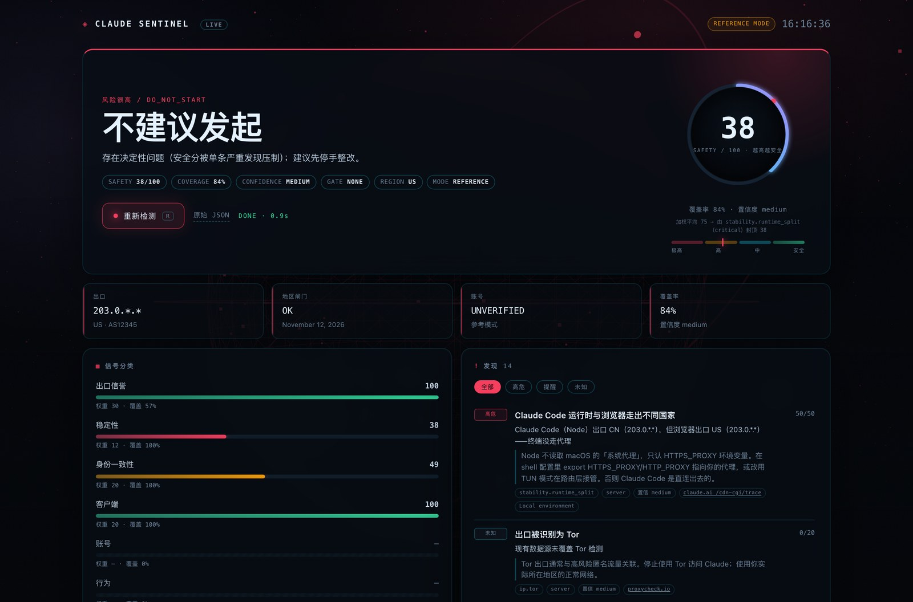

# Claude Sentinel

[](https://github.com/baobao1994/claude-sentinel/actions/workflows/ci.yml)
[](LICENSE)
[](pyproject.toml)

**本地只读的 Claude 环境自查工具。** 一条命令完成「官方区域闸门 → 网络出口 → 本地身份 → 客户端 → 账号」五层体检，给出可解释的安全分、按优先级排好的修复方式、明确的「能否发起对话」结论，并把每次环境写入本地历史，下次自动对比。

> 不是 Anthropic 官方产品。无法读取 Anthropic 内部风控、黑名单、支付或服务端历史；安全分是启发式，不是封号概率。



*截图使用文档网段（`203.0.*.*`）与合成数据，不含任何真实环境。*

---

## 快速开始

```bash
git clone https://github.com/baobao1994/claude-sentinel.git
cd claude-sentinel
uv sync
uv run sentinel
```

或安装为命令：

```bash
uv tool install .
sentinel
```

默认会：

1. 运行五层检测（约 10 秒，数据源失败会降级）；
2. 在终端打印 HUD；
3. 生成自包含 HTML 报告到 `~/.claude-sentinel/reports/` 并打开；
4. 把本次环境写入 `~/.claude-sentinel/sentinel.db`，供下次漂移对比。

要求 Python 3.10+；macOS 功能最全，Linux/Windows 自动降级。

### 双击启动动效面板（推荐用于录屏）

macOS Finder 里**双击 `sentinel-live.command`** 即可：

1. 首次运行自动 `uv sync` 准备环境；
2. 启动本地服务（端口占用自动顺延）；
3. 用 Chrome/Edge **应用窗口**打开（无地址栏/标签栏，录屏更干净）；
4. 打开后**自动开始检测**，并播放完整扫描动画；
5. 随时点「重新检测」或按 **R** 键再次检测。

也可以在终端里跑同样的入口：

```bash
./sentinel-live.command          # 应用窗口 + 自动检测
./sentinel-live.command --tab    # 用普通浏览器标签页
sentinel live --no-open          # 只起服务（自行访问给出的地址）
```

纯终端版（带扫描动画 + HTML 报告）：

```bash
./sentinel.sh                 # 等价于 uv run sentinel
./sentinel.sh --no-open       # 只打印 HUD，不开报告
```

### 实时 UI（three.js）

```bash
sentinel live
```

three.js 线框球体/星场、雷达扫描仪、动效仪表盘、实时阶段进度（17 个阶段由真实检测事件驱动，不是假进度条）、结果数字滚动、六轴条与发现列表逐条入场、历史与漂移。只监听本机；three.js 已内置在 wheel 中，不依赖 CDN。

---

## 它能回答什么

| 问题 | 回答方式 |
|---|---|
| 现在能不能发起对话？ | 结论大字：可以 / 可以但建议先处理 / 谨慎 / 不建议 / 不可（原因）/ 无法判断 |
| 当前环境是否适合用 Claude？ | 官方区域闸门 + 支持地区列表 + 服务状态 + 出口/身份一致性 |
| 风险在哪？ | 每条发现都有证据、严重度、分值、来源、Claude 可见性 |
| 怎么修？ | 按影响排序的 top 3 修复步骤；不自动改系统 |
| 账号被封了吗？ | 本部署**没有账号凭据**：明确标注「参考模式」，只评估环境，不推断账号状态 |
| 和上次比变了吗？ | IP/ASN/国家/时区/浏览器/指纹/分数/账号状态逐项 diff |
| Claude 到底能看到什么？ | `SERVER` / `BROWSER JS` / `LOCAL` 三层可见性矩阵 |
| 我的代理真的生效了吗？ | 分别探测 claude.ai / anthropic.com / api.anthropic.com / cloudflare.com 的出口 |
| 我是 TUN 还是系统代理？ | 读路由表与系统代理设置，判断终端是否绕过代理 |
| Claude Code 走的路和浏览器一样吗？ | 从 Node（Claude Code 运行时）与 curl 各自实测出口 |

---

## 常用命令

```bash
# 一键体检（默认）
sentinel
sentinel scan   # 等价写法

# 本地 three.js 动效面板
sentinel live          # 应用窗口 + 自动检测
sentinel live --tab    # 用普通浏览器标签页
sentinel serve         # 旧入口：只起服务不自动检测

# 机器可读 JSON（默认脱敏 IP）
sentinel --json --no-html --no-open > report.json

# 展开每条规则的证据与分值
sentinel --explain

# 用同一个代理检测 Claude 实际走的路径
sentinel --proxy socks5://127.0.0.1:7890

# 可选：只读探测账号状态（仅在你自备凭据时；默认不提供）
sentinel account --from-claude-code
pbpaste | sentinel account --cookie-stdin
echo "$OAUTH_TOKEN" | sentinel account --token-stdin

# 可选：真实浏览器采集 WebRTC / Canvas / 字体 / 浏览器出口
sentinel probe

# 历史与漂移
sentinel history --last 10
sentinel history --diff
sentinel history --prune

# 可选：行为维度（cron/shell/会话频率）
sentinel --deep

# 可选：账号画像（只影响账号维度）
sentinel profile

# 查看权重 / 规则 / 数据源
sentinel weights
sentinel rules
sentinel sources
```

退出码：`0` 可发起、`1` 需注意、`2` 高风险/不建议、`3` 硬阻断、`4` 无法判断。

> **参考模式**：本部署不包含账号凭据。没有 `sentinel account` 结果时，账号层只作参考，报告中的“能否发起对话”是**环境层结论**，不代表账号真实状态。

---

## 判定逻辑（摘要）

**硬闸门（命中即短路）**

1. 账号探测返回 `disabled` → 不可发起（账号停用）
2. 官方区域闸门 `region_unavailable` 或出口国家不在官方列表 → 不可发起（区域限制）
3. 官方组件非 operational → 暂不可发起（服务异常）
4. 系统时钟偏差 > 5 分钟 → 先校准时间
5. 关键数据源全部不可达 → 无法判断

**安全分（未命中闸门时；100 = 最干净，越高越安全）**

| 分类 | 权重 | 主要内容 |
|---|---:|---|
| 网络出口与信誉 | 30 | **多域名真实出口**、机房/VPN/代理/Tor、滥用分、RPKI 前缀校验、ASN 类型、RDAP 注册时间 |
| 本地身份一致性 | 20 | 时区/语言 vs 出口、**DNS 泄露**、中文字体/浏览器（弱信号） |
| 客户端与中转 | 20 | `ANTHROPIC_BASE_URL`、第三方中转、认证混用、旧版标记区间 |
| 出口稳定性 | 12 | IP/ASN/国家漂移、双栈不一致、**分域名出口不一致**、**TUN vs 系统代理**、WebRTC 泄露 |
| 账号画像 | 10 | 自报共享/多账号/历史封禁/支付地/注册地 |
| 行为模式 | 8 | 可选 deep：会话频率、cron、shell 批量调用 |

等级：`86–100 低`、`66–85 中`、`41–65 高`、`0–40 极高`。总体覆盖率 < 60% 或出口国家未知时，结论降级为「无法判断」，而不是假装安全。

**单条严重发现会封顶总分，不被平均稀释。** 分类内的分数虽是加权平均，但只要命中 `critical`/`high`
规则，该分类与总分的上限就被压制（critical 封顶 38、high 封顶 60，按命中比例插值）。
报告里的 `score_basis` 会写明算式，例如
「六轴加权平均 73；但 stability.runtime_split（critical）封顶 38，取较低者」——
分数不是黑箱。

详细公式、来源分层和局限见 [docs/METHODOLOGY.md](docs/METHODOLOGY.md)。

---

## 数据与隐私

- **本地只读**：对系统和账号只读；只写 `~/.claude-sentinel/` 下的历史与报告。
- **无遥测**：没有统计、广告或追踪；不会把报告上传到任何服务器。
- **IP 默认脱敏**：HTML/JSON 默认显示 `203.0.*.*`；终端默认显示完整 IP，`--show-ip` 可让报告显示完整值。
- **凭据不落盘**：`sentinel account` 只在内存中使用 token/sessionKey，最多缓存账号「状态」24 小时，不缓存凭据。
- **浏览器探针**：页面只回传 `127.0.0.1`；外部只访问 Cloudflare trace（测浏览器出口）和公共 STUN（WebRTC）。
- **deep 模式**：只统计 cron/shell 的聚合计数，不保存命令内容或对话内容。

完整数据流见 [docs/PRIVACY.md](docs/PRIVACY.md)。

---

## 明确不做

- 不做指纹伪造/随机化、代理轮换、账号切换、MachineGuid/device_id/遥测篡改。
- 不做「IP 纯净度/信任分」这类不透明第三方评分；只列事实（是否机房、RPKI 是否有效、ASN 类型），分数由本工具已公开的权重算出。
- 不提供 TUN/分流规则的自动配置，只检测「当前配的对不对」。
- 不自动发消息、不批量注册、不读取或保存 Cookie/Token 内容。
- 不提供不受支持地区的规避方案；只陈述官方政策与官方入口。
- 不声称能预测封号；没有官方账号信号时只说「未知/风险」。

---

## 开发

```bash
uv run ruff check src tests
uv run pytest
uv run sentinel --no-open --no-anim
uv build
```

目录：

```
src/claude_sentinel/
  collectors/   官方 / 网络 / IP 情报 / RDAP / 本地 / Claude Code / 账号 / 浏览器
  rules/        Python 规则函数 + 权重 + 来源
  render/       Rich 终端 HUD + Jinja2 自包含 HTML
  web/          本地 three.js 面板（SSE 实时阶段流 + 动效前端）
  progress.py   17 个检测阶段与进度事件（终端/Web 共用）
  launch.py     应用窗口 / 浏览器标签页启动
  pipeline.py   采集 → 规则 → 评分 → 结论 → 历史
  history.py    SQLite 快照与漂移
sentinel-live.command   双击启动动效面板（macOS）
sentinel.sh             终端版一键检测
tests/         解析器、评分、闸门、历史、脱敏、账号、HTML、CLI、SSE、启动器、mock 全链路
docs/          METHODOLOGY / PRIVACY / SOURCES
```

## License

MIT. 方法论参考了 [claude-analysis](https://github.com/Nooobhh/claude-analysis)（AGPL-3.0）、[claude-ban-risk-check](https://github.com/fourierwang66666/claude-ban-risk-check) 与 [FK Claude](https://claude.flowlab.im/) 的公开思路；未复制其代码。
